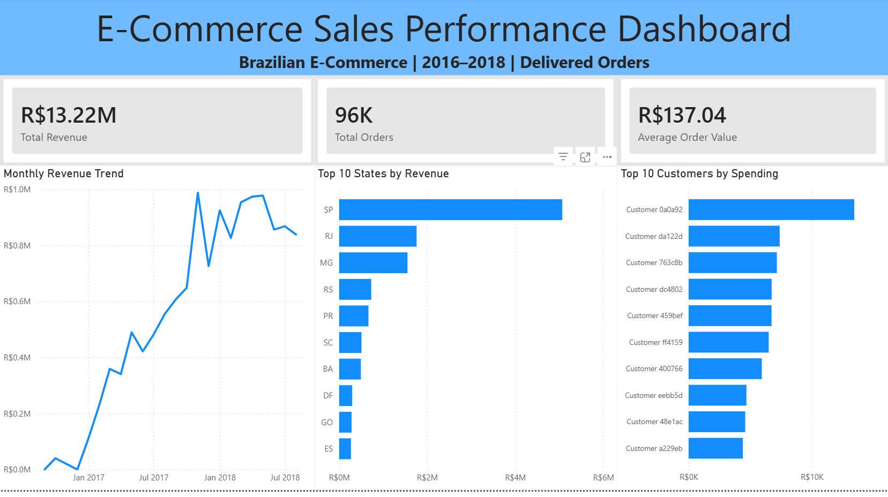

# E-Commerce Data Engineering & Sales Analytics

An end-to-end data engineering and analytics project using **Databricks, PySpark, SQL, Delta Lake, and Power BI** to process Brazilian e-commerce transactions and analyze sales performance.

## Dashboard Preview

## Tech Stack

- **Databricks:** Cloud-based data processing and analytics
- **PySpark:** Data ingestion, cleaning, and transformations
- **SQL:** Data joins, aggregations, and sales analytics
- **Delta Lake:** Storage for Bronze, Silver, and Gold tables
- **Power BI:** Interactive sales dashboard

## Project Architecture

The project follows the **Medallion Architecture**, consisting of three layers:

**Bronze — Raw Data Ingestion**
- Ingested the Olist Brazilian e-commerce CSV datasets into Databricks.
- Created Delta tables for orders, customers, and order items.
- Preserved original column values as strings before cleaning.

**Silver — Data Cleaning**
- Checked datasets for missing values and duplicate identifiers.
- Converted timestamps, prices, freight costs, and item identifiers to appropriate data types.
- Created cleaned Silver Delta tables for downstream analytics.

**Gold — Business Analytics**
- Joined orders, customers, and order items using SQL.
- Calculated monthly revenue, revenue by state, customer spending, and sales KPIs.
- Created four Gold Delta tables for reporting.
- Validated revenue consistency across KPI, monthly, and state summaries.

## Key Results

| Metric | Result |
|---|---|
| Total Product Revenue | R$13.22M |
| Delivered Orders | Approximately 96K |
| Average Order Value | R$137.04 |
| Highest-Revenue State | São Paulo (SP) |

*Revenue is calculated from item prices associated with delivered orders and excludes freight charges.*

## Power BI Dashboard

The dashboard includes:

1. Total Revenue, Total Orders, and Average Order Value KPI cards
2. Monthly Revenue Trend
3. Top 10 States by Revenue
4. Top 10 Customers by Spending

## Project Files

- `01_Bronze_Data_Ingestion.py` — Bronze data ingestion
- `02_Silver_Data_Cleaning.py` — Silver data cleaning
- `03_Gold_Sales_Analytics.sql` — Gold sales analytics
- `Ecommerce_Sales_Dashboard.pbix` — Power BI dashboard
- `dashboard.png` — Dashboard preview

## Dataset

This project uses the [Brazilian E-Commerce Public Dataset by Olist](https://www.kaggle.com/datasets/olistbr/brazilian-ecommerce), available on Kaggle.

## How to Reproduce

1. Create a Databricks catalog/schema and upload the required Olist CSV files to a Unity Catalog volume.
2. Adjust the file paths and table names in the notebooks to match your environment.
3. Run the Bronze ingestion notebook.
4. Run the Silver cleaning notebook.
5. Run the Gold analytics notebook.
6. Connect Power BI to the Gold tables using a Databricks SQL warehouse.

**Note:** The notebooks use full-table overwrites for this learning project and are intended to be run in order. The customer labels are added in a later Gold notebook step.
